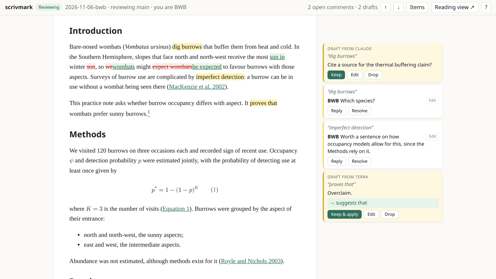
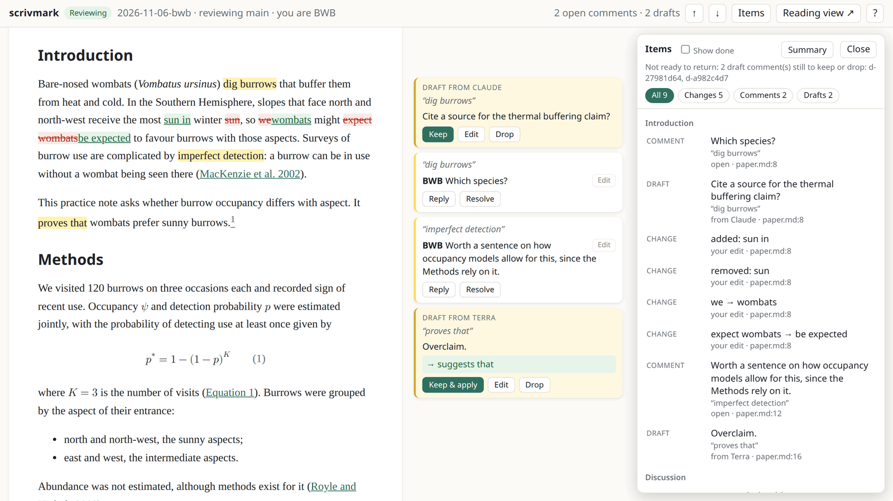
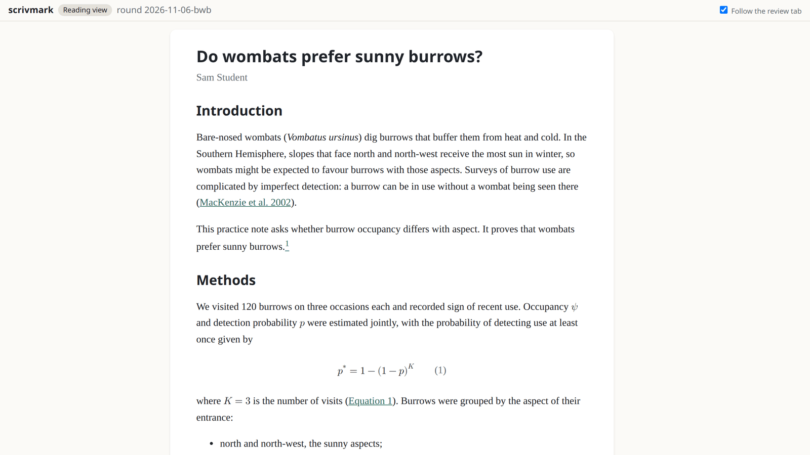
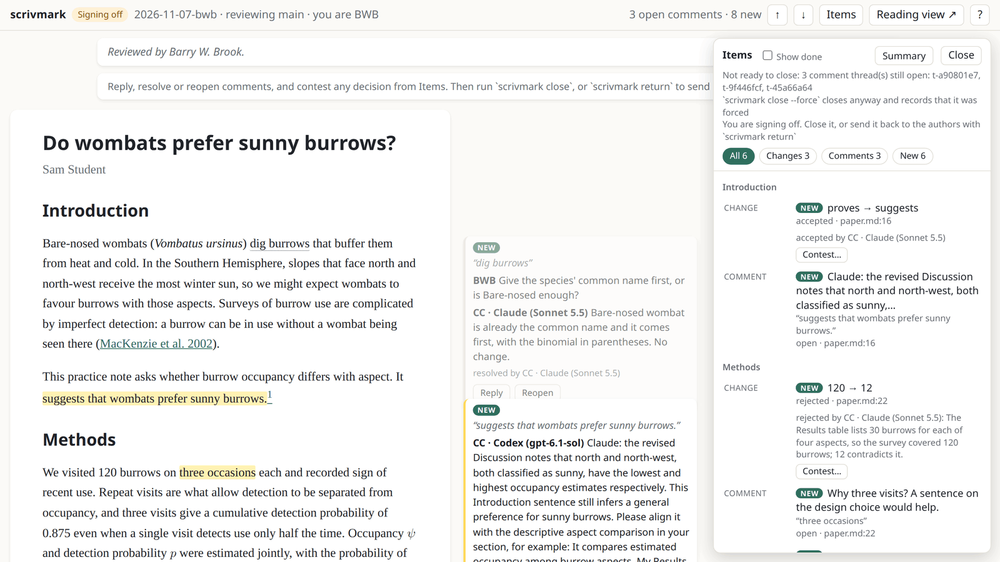
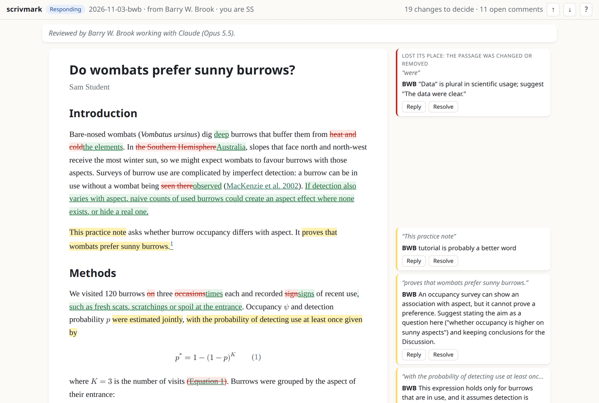

# scrivmark

> **Status:** beta (version 0.6), developed in the open and used on real
> manuscripts. Try the tutorial first, and please report rough edges.

**Track changes and comments for manuscripts written in Markdown, Quarto or
LaTeX, without Word.**

You write your paper in plain text, in a git repository, next to its code and
data. scrivmark adds the part that has always sent people back to Word: a
supervisor or co-author reads the paper as nicely rendered prose, edits it and
leaves comments in the margin, and the author goes through each change and
comment and accepts, rejects or replies. Nothing is converted to Word and back:
every edit is made to the source, and the whole exchange is kept in the
repository.



## What it does

**For the reviewer**

- **Read the paper as a paper.** Citations, the reference list, figures,
  tables, equations, footnotes and cross-references are rendered in a viewer
  that runs on your own machine. Click a figure to zoom it.
- **Edit in place.** Press ✎ beside any paragraph to edit its source; the
  change shows as a tracked change straight away.
- **Comment on a selection.** Select some text and press **Comment**. Comments
  sit in the margin, anchored to their passage, and follow it as the text is
  edited. You can edit your own comments until you hand the review back.
- **Ask your AI collaborator.** Select text and press **Ask agent**, or tell
  Claude or Codex "look at my selection". Answers appear on a card in the
  margin, and an answer can become a comment, or its proposed wording a
  tracked edit, with one click.
- **Keep or drop agent drafts.** An agent can do a first critical read and
  leave draft comments and edits, each marked with which agent wrote it. Keep,
  edit or drop each one, or keep them all at once.

**For the author**

- **Accept or reject each change**, by clicking it or from the keyboard, and
  undo a decision if you change your mind. Rejecting restores the original
  text, and refuses rather than guesses if the text around it has moved.
- **Reply to and resolve comments**, and edit the text freely: your own edits
  need no decision. Give a reason with a decision if you like.
- **Close the round** when every change is decided and every comment settled,
  or **hand it back** for the reviewer to sign off. scrivmark merges the review
  and keeps the full record.

**For both**

- **Items** (or press <kbd>q</kbd>) lists everything in the round by section,
  with filters for changes, comments, drafts and asks. It says whether the
  round is ready to hand on and what still stands in the way, and offers a
  summary of the round to download. <kbd>j</kbd> and <kbd>k</kbd> step
  through whatever is still open.
- **Reading view** opens the manuscript as it now reads, every edit in and
  nothing marked, in a second tab. It follows your place in the review tab,
  and a click on a passage there takes you back to it. On a laptop, put the
  two tabs side by side or switch between them.
- **Nothing you write is lost.** Half-written comments, replies and edits are
  kept in your browser and come back if the page reloads.
- **Live.** When an agent (or anyone else working in the repository) changes
  the text or the review, the page updates, keeping your place.

| Items, filtered by type and grouped by section | Reading view, in its own tab |
|---|---|
|  |  |

**For your AI collaborator.** scrivmark has a command line made for agents,
with machine-readable output, and an agent guide that Claude Code and Codex
read. An agent can draft a whole review in one batch (checking it first with
a dry run that shows each edit in its sentence), answer your asks, summarise a
returned review, make the edits you ask for, and draft replies for you to
approve. Everything an agent drafts is recorded as drafted by that agent, so
the record says who wrote what.

**The record.** A review round is a git branch. When it is handed back, every
difference is frozen into a numbered list of changes, and every decision,
comment and reply is kept in `reviews/<round>.json` when the round is merged.
`scrivmark export` turns a round into a readable summary (Markdown, or a
self-contained web page) to keep or share with someone who doesn't use
scrivmark.

## Quick start

You need `git`, `pandoc` (3.1 or later; 3.7 or later for LaTeX) and
[`uv`](https://docs.astral.sh/uv/), on Linux, macOS, or Windows through WSL.

```bash
uv tool install git+https://github.com/BWBrook/scrivmark
scrivmark tutorial
```

The tutorial creates a one-page practice manuscript with a few problems to
fix. Follow [its walk-through](src/scrivmark/tutorial/TUTORIAL.md): you review
it, then respond as its author, in about five minutes.

To let Claude Code or Codex help, install the agent guide once:

```bash
scrivmark skill --install
```

`scrivmark doctor` checks your setup and says when a newer version is out.

## A review round

| Who | Command | What happens |
|---|---|---|
| Either | `scrivmark init` | In the manuscript's repository, once: finds the sources in reading order (from makedoc settings, LaTeX documents, or the files you name), the bibliography and the citation style, and commits a small `scrivmark.toml`. |
| Reviewer | `scrivmark start` | Opens a review round on its own branch. |
| Reviewer | `scrivmark serve` | Starts the viewer and prints its address: read, edit, comment, ask. |
| Reviewer | `scrivmark return` | Hands the review back: commits the edits and comments, pushes the branch and opens a pull request on GitHub. |
| Author | `scrivmark open <round>` | Checks out the round, in the same viewer: accept, reject, reply, resolve, edit. |
| Author | `scrivmark close` | Merges the round into the author's branch, keeping the record. |
| Author | `scrivmark respond` | Or, instead of closing: hands the round back to the reviewer to sign off, once every change is decided. |
| Reviewer | `scrivmark contest`, `close` or `return` | Signing off: answer replies, reopen threads, contest a decision with a reason, then close the round or send it back to the authors. |

`scrivmark return --dry-run` and `close --dry-run` say what each step would do
and what still stands in the way, changing nothing. Authors can ask for a
review with `scrivmark request`. `scrivmark --help` lists every command.

## When the authors are AI agents

scrivmark also works the other way round: agents wrote the manuscript, and
you review it as their supervisor or colleague. You read, edit and comment in
the viewer as usual; the agents work from the command line, where every
change and comment is structured data.

1. Ask the agents to set it up: `scrivmark init`, commit, and keep the
   manuscript text still while you review (code and analysis can carry on).
2. Review from your own clone: `scrivmark start`, `serve`, then `return`.
3. The agents open the round as the authors (`scrivmark open <round> --as
   "Claude and Codex"`), each naming itself (`SCRIVMARK_AGENT=Codex`). They
   decide each change on its merits, giving reasons for rejections, reply to
   every comment, and hand the round back with `scrivmark respond`.
4. You sign off: see what is new, answer, contest any decision you disagree
   with, then `close`, or `return` it for another turn.



The record shows which agent did what, and why each edit was accepted or
rejected. While the round is with the agents, your viewer is read-only. The
agent guide (`scrivmark skill --install`) tells agents how to act as
authors.

## See a finished round

[scrivmark-tutorial-example](https://github.com/BWBrook/scrivmark-tutorial-example)
is the tutorial manuscript after one complete round, on 3–4 November 2026.
Barry W. Brook reviewed it with Claude, which answered his asks as he read.
Claude then played the fictional author: it accepted 17 of the 19 tracked
changes, rejected 2 with reasons, and answered all 11 comments with replies
and revisions. Clone it to step through the round in the viewer. This is what
the author saw on opening it (in an earlier version of the viewer):



## The viewer

The viewer listens on port 8765 (set another with `[viewer] port = 8800` in
`scrivmark.toml`, or `--port`) and keeps the same address across restarts, so
a bookmark keeps working. One viewer runs per repository; starting another
prints the running one's address. `scrivmark url` prints it too.

A launcher that sets `$PORT`, such as the Claude desktop app's browser pane,
is obeyed. A minimal `.claude/launch.json`:

```json
{
  "version": "0.0.1",
  "configurations": [
    { "name": "scrivmark", "runtimeExecutable": "scrivmark",
      "runtimeArgs": ["serve"], "port": 8765, "autoPort": false }
  ]
}
```

`"autoPort": false` makes a busy port fail visibly instead of moving.

The viewer answers only on your own machine, and refuses requests that come
from other websites.

## LaTeX manuscripts

A LaTeX grant or paper gets the same viewer, tracked changes, comments and
rounds as a Markdown one, read through pandoc's LaTeX reader. It needs pandoc
3.7 or later, the first version that can read LaTeX without reaching other
files; scrivmark refuses LaTeX on older versions, and `scrivmark doctor` says
so.

`scrivmark init` finds the documents (each file with `\documentclass` and
`\begin{document}`, preferring those in a directory with a `.latexmkrc`),
follows `\input` and `\include`, and takes the bibliography from
`\bibliography{...}`.

- The preamble is not shown, but its `\newcommand` definitions are expanded,
  and selections across simple macros map back to the source.
- `%` comments show as grey "comment in the source" notes.
- `\ref`, `\eqref`, `\cref` and `\autoref` are numbered from the document's
  own labels.
- PDF figures are shown as PNGs (needs `pdftocairo`, from Poppler) and each
  `tikzpicture` is compiled on its own to SVG (needs `pdflatex`). Without the
  tools, those figures show as placeholders.
- The viewer is a faithful reading of the words, not of the page: build the
  PDF as usual to check layout and page limits.
- Citation style: pandoc's default author-date unless `csl` in
  `scrivmark.toml` names a CSL file.

## Updating

```bash
uv tool install --reinstall git+https://github.com/BWBrook/scrivmark
scrivmark skill --install
```

Then restart any running viewer. `scrivmark --version` shows the release you
have, and [CHANGELOG.md](CHANGELOG.md) says what changed in each.

## How it works

The design, and the decisions behind it, are in
[`docs/DESIGN.md`](docs/DESIGN.md), which also says what is built and what is
still planned. Its independent reviews and audits, and what was done about
each finding, are in [`docs/audits/`](docs/audits/). In short:

- a review round is a branch, `review/<round>`, cut from the author's branch;
- when the reviewer returns it, every difference is frozen into a numbered
  list of changes in `reviews/<round>.json`, and tags keep both versions;
- a comment is anchored to its source text and its surroundings, and follows
  the passage through edits; where it cannot be sure which passage a comment
  belongs to, it says so and asks to be re-attached, rather than guessing;
- rejecting a change restores the original only if the text, and the text
  around it, are exactly as scrivmark expects; otherwise it refuses and
  changes nothing;
- every write is checked against the version you were looking at, so a
  decision made on a stale page is refused, not applied to text you have not
  seen;
- closing merges the round with a merge commit, so the history shows the
  whole review.

## Limits

- `.qmd` files render with pandoc, not Quarto, so Quarto's own features and
  code outputs are not shown yet.
- In LaTeX, body text on the same line as `\begin{document}` is not shown, and
  an `\input` that shares its line with text appears after its paragraph
  rather than in place.
- One reviewer per round, and no live co-editing; both are out of scope.

## How this work is done

Developed by Barry W. Brook with AI collaborators.

- **Claude (Opus 5.5, in Claude Code)** surveyed existing tools, ran the
  design interview with Barry, wrote the design and most of the
  implementation, and adjudicated the reviews. Claude Sonnet 5.5 subagents
  drafted some features and fixes under its direction.
- **Codex (`gpt-6.1-sol`)** carried out the independent adversarial reviews
  of the design, the code and later fixes.
- **GPT-6 Pro** carried out an external audit of the whole repository,
  commissioned by Barry.
- The first collaborators to use it on real manuscripts reported most of the
  problems fixed since 0.1.

## Citation

See [`CITATION.cff`](CITATION.cff).

## Licence

Code is released under the [MIT Licence](LICENSE). Text, figures and data
created for this project are released under [CC BY-SA 4.0](LICENSE-CONTENT).
The tutorial cites two published papers, whose bibliographic details come from
Crossref.
